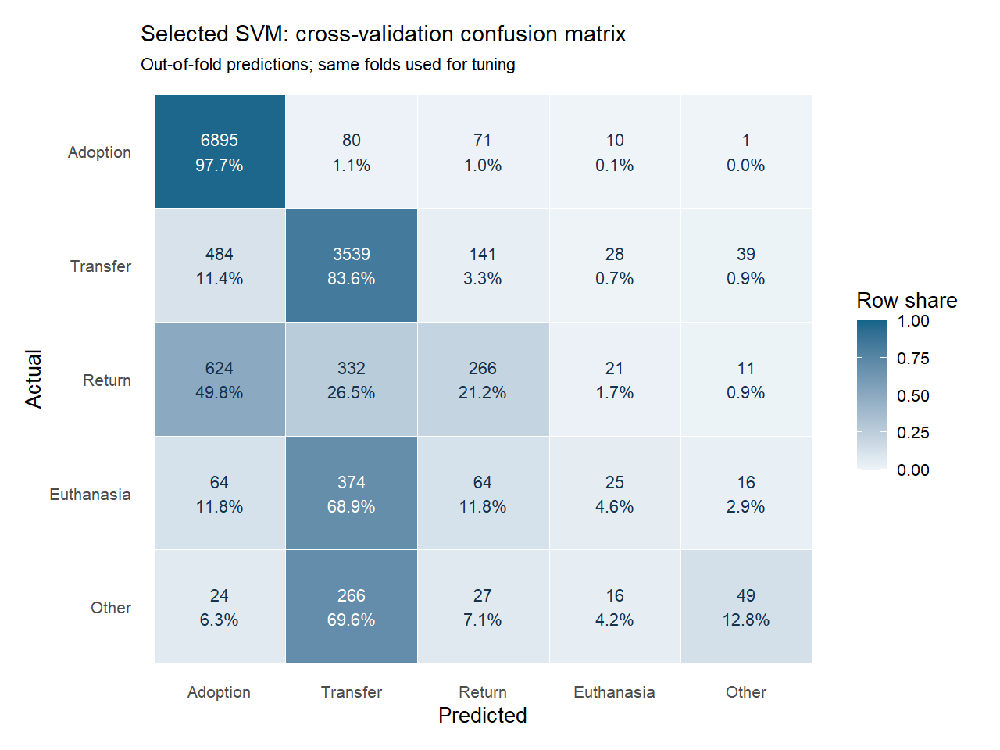
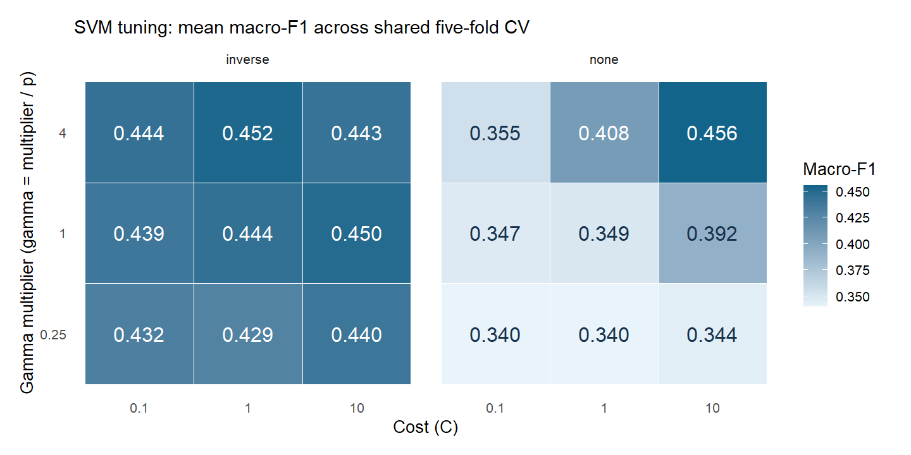

<style>
/* Compact but visibly hierarchical report typography. */
.title {
  font-size: 28px;
  line-height: 1.08;
  margin: 0 0 4px 0;
}
.author {
  font-size: 14px;
  margin: 0 0 8px 0;
}
h2 {
  font-size: 20px;
  line-height: 1.12;
  margin-top: 13px;
  margin-bottom: 5px;
}
h3 {
  font-size: 17px;
  line-height: 1.12;
  margin-top: 11px;
  margin-bottom: 4px;
}
h4 {
  font-size: 15px;
  line-height: 1.12;
  margin-top: 9px;
  margin-bottom: 3px;
}
p { margin: 0 0 5px 0; }
ul, ol { margin-top: 2px; margin-bottom: 6px; }
li > p { margin-bottom: 2px; }
table { margin-top: 4px; margin-bottom: 6px; }

@media print {
  @page { size: Letter; margin: 12mm; }
  body {
    font-size: 14px;
    line-height: 1.22;
  }
  .btn, .code-folding-btn, button { display: none !important; }
  .main-container {
    max-width: none !important;
    width: 100% !important;
    margin: 0 !important;
    padding: 0 !important;
  }
}
</style>

## 1. Problem Framing & Research Question

Animal center accepts a variety of animals from wildlife to owned pet. Our dataset is Austin Animal Center Outcomes from official city of Austin open data portal showing information of animals with outcomes such as return to owner, adoption, etc. We will investigate which animal characteristics are associated with different shelter outcomes and aim to predict the outcomes of dogs and cats using information available at intake.

**Task and relevance:** Predict the final outcome of cats and dogs—Adoption, Transfer, Return, Euthanasia, or Other—from information available at intake. This real-world task is relevant to shelters managing overcrowding and limited resources.

**Stakeholders:** Shelter staff, animal-care teams, adoption and transfer coordinators, and managers allocating shelter resources.

**Research question:** To what extent can intake-time information of cats and dogs predict these five shelter outcomes for each animal's latest recorded admission?

**Motivation:** Early predictions may help staff prioritise care, allocate resources, and identify animals at greater risk of unfavourable outcomes.

## 2. Dataset & Justification

#### Data Source(s)

The [Austin Animal Center Outcomes](https://data.austintexas.gov/d/gsvs-ypi7) dataset is published by the City of Austin Open Data Portal and maintained by Austin Animal Services.

#### Dataset Justification

It records animal characteristics, intake information, and final shelter outcomes. We initially select 16,342 cat and dog records labelled as `Dog`, `Puppy`, `Cat`, or `Kitten`. EDA describes this initial subset. The modelling analysis uses one record per animal: its most recent recorded intake within this subset. This selection is implemented as the first step of Data Preprocessing. The dataset directly addresses our research question because it contains both intake-time characteristics and the final outcome to be predicted. It satisfies the **Large**, **Messy**, and **Multi-class** project criteria.

1.  **Large Size (\>10,000 observations)**

Before preprocessing, the selected dataset contains **16,342 observations**, exceeding the 10,000-observation threshold. This supports model training and stratified cross-validation, while efficient encoding and controlled tuning will be used to manage the computational cost of comparing five models.

2.  **Messy (missing values)**

The data require variable-specific cleaning. Missingness occurs in `Name` (37.92%), `Secondary.Color` (47.73%), and `Date.of.Birth` (4.35%); `Spayed.Neutered` also contains inconsistent recording. The combined figure below shows these missingness patterns.

3.  **Multi-class（5 classes）**

The cat-and-dog subset contains **28 distinct raw `Outcome.Status` categories**. Many are administrative variations of the same terminal outcome, while several contain only a few observations. Retaining all 28 would create sparse classes, unstable estimates, and unreliable cross-validation. We therefore consolidate categories with the same operational meaning into five outcomes:

- **Adoption** — 8,836 observations (54.07%): Adopted, Adopted Altered, Adopted Offsite, Adopted Offsite (Altered or Unaltered), Adopted Unaltered, and Adopted to Finder.
- **Transfer** — 4,893 observations (29.94%): Transfer Out.
- **Return** — 1,565 observations (9.58%): Reclaimed, Returned to Owner, Redemption (Offsite), and Return to Habitat.
- **Euthanasia** — 623 observations (3.81%): Euthanized and Euthanasia--RTO.
- **Other** — 425 observations (2.60%): the remaining death, cremation, and rare administrative outcomes, including DOA, Unassisted Death, Cremated or Interred, Lost, Escaped, Stolen, Unresolved File, and Bite Quarantine.

This mapping preserves the principal shelter outcomes while producing class sizes suitable for multi-class modelling. The target remains imbalanced: Adoption accounts for 54.07% of records, whereas Euthanasia and Other account for only 3.81% and 2.60%. Therefore, final evaluation will emphasise macro-F1, balanced accuracy, and per-class recall rather than overall accuracy alone.

```{r dataset-scope, message=FALSE, warning=FALSE, fig.width=12, fig.height=3.8, out.width="100%", fig.align='center'}
knitr::opts_chunk$set(
  message = FALSE,
  warning = FALSE
)

library(tidyr)
library(dplyr)
library(stringr)
library(forcats)
library(ggplot2)
library(scales)
library(patchwork)

# The CSV is stored in the same folder as this R Markdown file.
data <- read.csv(
  "Austin_Animal_Center_Outcomes_20260916.csv",
  stringsAsFactors = TRUE
)

# Restrict the scope to cats and dogs and consolidate the 28 raw outcomes.
data_selected <- data %>%
  filter(Type %in% c("Dog", "Puppy", "Cat", "Kitten")) %>%
  mutate(
    Outcome.Group = case_when(
      str_detect(Outcome.Status, regex("Adopt", ignore_case = TRUE)) ~ "Adoption",
      str_detect(Outcome.Status, regex("Transfer", ignore_case = TRUE)) ~ "Transfer",
      str_detect(Outcome.Status, regex("Euthan", ignore_case = TRUE)) ~ "Euthanasia",
      str_detect(
        Outcome.Status,
        regex("Reclaim|Redemption|Returned To Owner|Return to Habitat", ignore_case = TRUE)
      ) ~ "Return",
      TRUE ~ "Other"
    ),
    Outcome.Group = factor(
      Outcome.Group,
      levels = c("Adoption", "Transfer", "Return", "Euthanasia", "Other")
    )
  )

group_summary <- data_selected %>%
  count(Outcome.Group, name = "Count") %>%
  mutate(
    Percentage = 100 * Count / sum(Count),
    Outcome.Group = factor(Outcome.Group, levels = levels(data_selected$Outcome.Group))
  )

key_missing <- c(
  "Name", "Euthanasia.Reason", "Secondary.Color",
  "Date.of.Birth", "Spayed.Neutered"
)

missing_summary <- tibble(
  Feature = key_missing,
  Missing_Pct = sapply(
    key_missing,
    function(feature) {
      values <- data_selected[[feature]]
      100 * mean(is.na(values) | trimws(as.character(values)) == "")
    }
  )
) %>%
  arrange(Missing_Pct) %>%
  mutate(Feature = factor(Feature, levels = Feature))

p_large <- ggplot(
  tibble(Scope = "Cats and dogs", Observations = nrow(data_selected)),
  aes(x = Scope, y = Observations)
) +
  geom_col(width = 0.55, fill = "#4C78A8") +
  geom_hline(yintercept = 10000, linetype = "dashed", colour = "#B24C63") +
  geom_text(aes(label = scales::comma(Observations)), vjust = -0.4, size = 3.5) +
  annotate("text", x = 1.28, y = 10000, label = "10,000 requirement", size = 2.8) +
  scale_y_continuous(labels = scales::comma, expand = expansion(mult = c(0, 0.16))) +
  labs(title = "Large", x = NULL, y = "Observations") +
  theme_minimal(base_size = 9) +
  theme(panel.grid.minor = element_blank())

p_missing <- ggplot(missing_summary, aes(x = Feature, y = Missing_Pct)) +
  geom_col(width = 0.6, fill = "#F2A65A") +
  geom_text(
    aes(label = sprintf("%.1f%%", Missing_Pct)),
    hjust = -0.1,
    size = 2.8
  ) +
  coord_flip() +
  scale_y_continuous(
    limits = c(0, 105),
    breaks = c(0, 25, 50, 75, 100),
    labels = scales::label_percent(scale = 1)
  ) +
  labs(title = "Messy", x = NULL, y = "Missing values") +
  theme_minimal(base_size = 9) +
  theme(panel.grid.minor = element_blank())

p_class <- ggplot(group_summary, aes(x = Outcome.Group, y = Count)) +
  geom_col(width = 0.65, fill = "#59A14F") +
  geom_text(
    aes(label = sprintf("%.1f%%", Percentage)),
    vjust = -0.35,
    size = 2.8
  ) +
  scale_y_continuous(labels = scales::comma, expand = expansion(mult = c(0, 0.16))) +
  labs(title = "Multi-class", x = NULL, y = "Observations") +
  theme_minimal(base_size = 9) +
  theme(
    panel.grid.minor = element_blank(),
    axis.text.x = element_text(angle = 30, hjust = 1)
  )

criteria_plot <- p_large + p_missing + p_class +
  plot_annotation(title = "Evidence for the three dataset criteria")

print(criteria_plot)
```

## 3. EDA & Insights

**1. Dataset Overview and Data Quality** — the original outcomes file contains `r scales::comma(nrow(data))` records and `r ncol(data)` columns. Each row represents an outcome record, and the same animal may appear in more than one record. The original columns include identifiers, animal characteristics, outcome information, dates and administrative metadata; they are not all predictors.

**Original dataset variables.** The table below introduces all original columns using their CSV names; planned transformations are implemented only in Data Preprocessing. In the R code, `read.csv()` converts spaces and punctuation to dots, for example `Animal ID` becomes `Animal.ID` and `Spayed/Neutered` becomes `Spayed.Neutered`.

| Original column | Meaning and role | Data type | Planned analytical use |
|-----------------|------------------|-----------|----------------------|
| `ID` | Identifier for an individual record | Identifier | Record checks; excluded from predictors |
| `Outcome Date` | Recorded date and time of the outcome | Date/time | Excluded: unavailable at intake |
| `Animal ID` | Identifier linking records for the same animal | Identifier | Select each animal's latest intake record during preprocessing; excluded from predictors |
| `Name` | Recorded animal name | Text | Derive `has_Name` |
| `Outcome Status` | Recorded outcome category | Categorical | Consolidate into the response `Outcome.Group`; excluded from predictors |
| `Euthanasia Reason` | Recorded reason for euthanasia, where applicable | Text/categorical | Excluded: outcome-related information |
| `Type` | Recorded animal type, including species and life-stage labels | Categorical | Select Dog/Puppy/Cat/Kitten records, then recode to Dog/Cat |
| `Sex` | Recorded sex | Categorical | Standardise as `Sex` |
| `Spayed/Neutered` | Recorded spay/neuter status | Categorical | Standardise as `Spayed.Neutered`; verify intake-time availability |
| `Primary Breed` | Recorded primary breed | Categorical | Derive `primary.breed.group` |
| `Primary Color` | Recorded primary coat colour or pattern description | Categorical | Derive `Base_Color` and contribute to `has_pattern` |
| `Secondary Color` | Recorded secondary coat colour, if present | Categorical | Contribute to `has_pattern` |
| `Date of Birth` | Recorded birth date | Date/time | Combine with intake date to derive `Age_Years` |
| `Intake Date` | Recorded date and time of intake | Date/time | Select the latest intake record and combine with birth date to derive `Age_Years` |
| `Days in Shelter` | Recorded duration of the shelter stay | Numeric | Excluded: completed stay duration is unavailable at intake |
| `Timestamp` | Timestamp supplied with the record | Date/time metadata | Excluded: administrative metadata |

**Analysis scope.** EDA examines the `r scales::comma(nrow(data_selected))` selected records using their original predictor values. The `data_eda` object remains an unchanged copy of `data_selected` throughout this section. Separate audit and plotting summaries describe missingness, inconsistencies and associations with `Outcome.Group`. The original colour figure uses its own separate plotting copy to reproduce the v12 categories. Selection of each animal's latest intake record, model-input construction, invalid-value replacement, imputation, splitting, encoding and scaling begin in Data Preprocessing. The EDA summaries therefore describe the initial records, before selection of the final modelling sample.

**Data-quality checks.** Date differences are calculated to inspect age at intake. Negative results are retained as negative values in the audit and counted separately from missing dates. No age is replaced or imputed during EDA.

```{r eda-data-quality, message=FALSE, warning=FALSE}
library(lubridate)

# EDA audit helpers: inspect blanks and read date strings without changing the source.
is_blank <- function(x) {
  is.na(x) | trimws(as.character(x)) == ""
}

parse_shelter_date <- function(x) {
  as.Date(parse_date_time(
    as.character(x),
    orders = c("Y b d I M S p", "ymd HMS", "mdy HMS", "dmy HMS",
               "ymd", "mdy", "dmy"),
    locale = "C", tz = "UTC", quiet = TRUE
  ))
}

# Keep this copy unchanged throughout EDA.
data_eda <- data_selected

# age check
age_audit <- tibble(
  DOB = parse_shelter_date(data_eda$Date.of.Birth),
  Intake_Date = parse_shelter_date(data_eda$Intake.Date)
) %>%
  mutate(Age_Years_raw = as.numeric(Intake_Date - DOB) / 365)

quality_features <- c(
  "Type", "Sex", "Spayed.Neutered", "Primary.Breed",
  "Primary.Color", "Secondary.Color", "Name", "Date.of.Birth", "Intake.Date"
)
quality_summary <- tibble(
  Feature = quality_features,
  Distinct_nonblank = sapply(quality_features, function(v) {
    x <- as.character(data_eda[[v]])
    n_distinct(x[!is_blank(x)])
  }),
  Missing_n = sapply(quality_features, function(v) sum(is_blank(data_eda[[v]]))),
  Missing_pct = 100 * Missing_n / nrow(data_eda),
  Unknown_label_n = sapply(quality_features, function(v) {
    sum(str_to_lower(trimws(as.character(data_eda[[v]]))) == "unknown",
        na.rm = TRUE)
  })
)
knitr::kable(quality_summary, digits = 2,
             caption = "Raw-field quality in the complete cat-and-dog subset")

quality_checks <- tibble(
  Check = c("Records", "Distinct nonmissing Animal IDs", "Exact duplicate rows",
            "Animal IDs with more than one record", "Missing Animal IDs",
            "Nonblank birth dates that failed parsing",
            "Nonblank intake dates that failed parsing",
            "Age unavailable from dates", "Negative ages observed"),
  Count = c(
    nrow(data_eda),
    n_distinct(data_eda$Animal.ID[!is_blank(data_eda$Animal.ID)]),
    sum(duplicated(data_eda)),
    sum(table(data_eda$Animal.ID[!is_blank(data_eda$Animal.ID)]) > 1),
    sum(is_blank(data_eda$Animal.ID)),
    sum(!is_blank(data_eda$Date.of.Birth) & is.na(age_audit$DOB)),
    sum(!is_blank(data_eda$Intake.Date) & is.na(age_audit$Intake_Date)),
    sum(is.na(age_audit$Age_Years_raw)),
    sum(age_audit$Age_Years_raw < 0, na.rm = TRUE)
  )
)
knitr::kable(quality_checks, caption = "Record and date checks")

```

The audit identifies `r sum(is.na(age_audit$Age_Years_raw))` unavailable ages and a further `r sum(age_audit$Age_Years_raw < 0, na.rm = TRUE)` negative ages. These are separate data-quality findings. Negative ages remain in the audit; their conversion to missing values is a later preprocessing decision. Repeated Animal IDs may represent separate shelter episodes rather than duplicate records. To use one observation per animal for modelling, the first preprocessing step retains each animal's most recent recorded intake.

```{r eda-plot-helpers}
# These functions aggregate observed categories
outcome_colours <- setNames(
  c("#66C2A5", "#FC8D62", "#8DA0CB", "#E78AC3", "#A6D854"),
  levels(data_eda$Outcome.Group)
)

outcome_summary <- function(df, feature) {
  df %>%
    mutate(Level = as.character(.data[[feature]])) %>%
    select(Level, Outcome.Group) %>%
    count(Level, Outcome.Group, .drop = FALSE) %>%
    group_by(Level) %>%
    mutate(Total = sum(n), Prop = n / Total) %>%
    ungroup()
}

# Axis labels distinguish NA, blanks and whitespace without changing their values.
display_eda_level <- function(x) {
  labels <- as.character(x)
  labels[is.na(x)] <- "<NA>"
  labels[!is.na(x) & x == ""] <- "<blank>"
  whitespace <- !is.na(x) & x != "" & trimws(x) == ""
  labels[whitespace] <- "<whitespace>"
  labels
}

plot_outcome_summary <- function(summary, title) {
  totals <- distinct(summary, Level, Total)
  ggplot(summary, aes(x = Level, y = Prop, fill = Outcome.Group)) +
    geom_col(width = 0.6) +
    scale_x_discrete(labels = function(x) {
      paste0(display_eda_level(x), "\n(n=",
             scales::comma(totals$Total[match(x, totals$Level)]), ")")
    }) +
    scale_y_continuous(labels = percent_format(),
                       expand = expansion(mult = c(0, 0.03))) +
    scale_fill_manual(values = outcome_colours, drop = FALSE) +
    labs(title = title, x = NULL, y = "Within-group proportion", fill = "Outcome") +
    theme_minimal(base_size = 9) +
    theme(plot.title = element_text(face = "bold", size = 10),
          axis.text.x = element_text(angle = 30, hjust = 1),
          panel.grid.minor = element_blank(), legend.position = "bottom")
}

plot_outcome <- function(df, feature, title) {
  plot_outcome_summary(outcome_summary(df, feature), title)
}

plot_outcome_heatmap <- function(summary, title) {
  totals <- distinct(summary, Level, Total)
  ggplot(summary, aes(x = Outcome.Group, y = Level, fill = Prop)) +
    geom_tile(colour = "white") +
    geom_text(aes(label = if_else(Prop >= 0.08, sprintf("%.0f%%", 100 * Prop), "")),
              size = 3) +
    scale_y_discrete(labels = function(x) {
      paste0(display_eda_level(x), " (n=",
             scales::comma(totals$Total[match(x, totals$Level)]), ")")
    }) +
    scale_fill_gradient(low = "#F0F4F8", high = "#1F78B4", labels = percent_format()) +
    labs(title = title, x = NULL, y = NULL, fill = "Proportion") +
    theme_minimal(base_size = 9) +
    theme(plot.title = element_text(face = "bold", size = 10),
          panel.grid = element_blank())
}

outcome_rate <- function(feature, level, outcome) {
  x <- outcome_summary(data_eda, feature)
  index <- !is.na(x$Level) & x$Level == level & x$Outcome.Group == outcome
  value <- x$Prop[index]
  if (length(value) == 0L) return("not observed")
  sprintf("%.1f%%", 100 * value)
}
```

**2. Type and Type-Age Redundancy** — the original four labels are retained throughout EDA. Puppy and Kitten already describe life stage as well as species, so their relationship with observed age indicates overlapping information. The age summaries use only nonnegative observed ages, with missing and negative counts reported separately. The outcome comparison also uses the four original categories; the Dog/Cat recoding is performed later.

```{r type-outcome, fig.width=9, fig.height=3.5, out.width="85%", fig.align="center"}
# Summarise original Type values
type_age_summary <- tibble(
  Type = data_eda$Type,
  Age_Years_raw = age_audit$Age_Years_raw
) %>%
  group_by(Type, .drop = TRUE) %>%
  summarise(
    n = n(),
    Missing_age = sum(is.na(Age_Years_raw)),
    Negative_age = sum(Age_Years_raw < 0, na.rm = TRUE),
    Median_age = median(Age_Years_raw[!is.na(Age_Years_raw) & Age_Years_raw >= 0]),
    Q1 = quantile(Age_Years_raw[!is.na(Age_Years_raw) & Age_Years_raw >= 0], 0.25),
    Q3 = quantile(Age_Years_raw[!is.na(Age_Years_raw) & Age_Years_raw >= 0], 0.75),
    .groups = "drop"
  )
knitr::kable(type_age_summary, digits = 2,
             caption = "Original Type categories and observed nonnegative age")
p_type_outcome <- plot_outcome(data_eda, "Type", "Shelter Outcome by Original Type")
print(p_type_outcome)
```

The Return proportions are `r outcome_rate("Type", "Dog", "Return")` for Dog, `r outcome_rate("Type", "Puppy", "Return")` for Puppy, `r outcome_rate("Type", "Cat", "Return")` for Cat and `r outcome_rate("Type", "Kitten", "Return")` for Kitten. Alongside the age summaries, these differences motivate representing species and continuous age separately in the modelling dataset.

**3. Primary Breed** — there are 193 distinct breeds recorded, but the top 8 alone cover over 80% of all animals in the filtered dataset, and many breeds have only one observation. To limit sparse categories, Data Preprocessing retains the eight most common non-Unknown breeds identified in each training partition and groups all remaining or unseen breeds as "Other". The figure below describes the original breed distribution; the retained breeds for modelling are determined from the corresponding training data only.

```{r, fig.width=9, fig.height=3.5, out.width="85%", fig.align='center'}
library(ggplot2)
breed_summary <- data_selected %>%
  count(Primary.Breed, name = "Count") %>%
  arrange(desc(Count)) %>%
  mutate(
    Rank = row_number(),
    Pct = Count / sum(Count) * 100,
    Cum_Pct = cumsum(Pct)
  )

elbow_breed_rank <- 8
elbow_breed_val <- breed_summary$Cum_Pct[elbow_breed_rank]

# line plot for accumulated breed distribution
p_breed_elbow <- ggplot(breed_summary, aes(x = Rank, y = Cum_Pct)) +
  geom_area(fill = "#1f78b4", alpha = 0.12) +
  geom_line(color = "#1f78b4", linewidth = 1.2) +
  geom_hline(yintercept = 80, linetype = "dashed", color = "#666666", linewidth = 0.6) +
  geom_vline(xintercept = elbow_breed_rank, linetype = "dashed", color = "#666666", linewidth = 0.6) +
  geom_point(data = filter(breed_summary, Rank == elbow_breed_rank), 
             color = "#e31a1c", size = 3.5) +
  geom_point(data = filter(breed_summary, Rank == elbow_breed_rank), 
             color = "white", size = 1.5) +
  scale_x_continuous(
    breaks = c(1, 8, 25, 50, 100, 150, 193),
    expand = expansion(mult = c(0.01, 0.03))
  ) +
  scale_y_continuous(
    limits = c(0, 103),
    breaks = seq(0, 100, by = 20),
    labels = function(x) paste0(x, "%"),
    expand = expansion(mult = c(0, 0.01))
  ) +
  labs(
    title = "Primary Breed Cumulative Coverage",
    x = "Breed Rank (Ordered by Population Frequency)",
    y = "Cumulative Share of Population"
  ) +
  theme_minimal(base_size = 12) +
  theme(
    plot.title = element_text(face = "bold", size = 13, color = "#1a1a1a"),
    plot.subtitle = element_text(color = "#555555", margin = margin(b = 10)),
    panel.grid.minor = element_blank(),
    panel.grid.major = element_line(color = "#ebebeb"),
    axis.line = element_line(color = "#cccccc"),
    axis.title = element_text(face = "bold", size = 10.5)
  )

print(p_breed_elbow)
```
**4. Colour** — the raw data records `Primary.Color` and `Secondary.Color` separately, and most primary colours already map onto a small set of recognisable base colours. We first group `Primary.Color` into a `Base_Color` category, then derive a second feature, `has_pattern`, flagging animals that either have a non-empty `Secondary.Color` or whose primary colour description contains a patterned-coat keyword (Tabby, Brindle, Calico, Torbie, Point, Smoke, Tri Color, etc.) as "Mixed" rather than "Pure". White/Cream animals show the highest Return-to-Owner proportion of any colour group, while Blue/Grey animals show a comparatively higher Euthanasia proportion in the proportional comparison below.


```{r, fig.width=9, fig.height=3.5, out.width="85%", fig.align='center'}
# library(tidyverse)
# 
# # 
# raw_colors <- colour_eda$Primary.Color[!is.na(colour_eda$Primary.Color) & trimws(colour_eda$Primary.Color) != ""]
# 
# 
# tokens <- unlist(strsplit(tolower(raw_colors), "[^a-zA-Z]+"))
# tokens <- tokens[tokens != ""]  
# 
# word_freq <- as.data.frame(table(word = tokens), stringsAsFactors = FALSE) %>%
#   rename(n = Freq) %>%
#   arrange(desc(n)) %>%
#   mutate(pct = round(n / sum(n) * 100, 2))
# write.csv(word_freq, 'word_freq.csv')
# Group base_color type and Check if pattern
# Use a plotting copy; keep the original selected records unchanged.
colour_eda <- data_eda %>%
  mutate(
    Base_Color = case_when(
      str_detect(str_to_lower(Primary.Color), regex("brown|tan|choc|fawn|buff|sable|liver|cinnamon|rust|agouti|bronze|chestnut|sandy|seal", ignore_case = TRUE)) ~ "Brown/Tan",
      str_detect(str_to_lower(Primary.Color), regex("black|charcoal|sooty", ignore_case = TRUE)) ~ "Black",
      str_detect(str_to_lower(Primary.Color), regex("white|cream|blonde|albino|champagne|wheat|snow", ignore_case = TRUE)) ~ "White/Cream",
      str_detect(str_to_lower(Primary.Color), regex("blue|grey|gray|silver|lilac|wolf", ignore_case = TRUE)) ~ "Blue/Grey",
      str_detect(str_to_lower(Primary.Color), regex("orange|red|ginger|yellow|gold|apricot|lemon|flame", ignore_case = TRUE)) ~ "Orange/Red",
      TRUE ~ "Other"
    ),
    Base_Color = as.factor(Base_Color),
    has_pattern = if_else(
      (!is.na(Secondary.Color) & Secondary.Color != '') |
      str_detect(str_to_lower(Primary.Color), regex("tabby|brindle|smoke|Point|calico|torbie|tort|tri|merle|tiger|ticked|lynx|roan|bicolor|patch|shaded", ignore_case = TRUE)),
      "Mixed",
      "Pure"
    ),
    has_pattern = as.factor(has_pattern)
  )


# Base_Color distribution
p_base_bar <- ggplot(colour_eda, aes(x = Base_Color, fill = Base_Color)) +
  geom_bar(width = 0.6, show.legend = FALSE) +
  geom_text(
    stat = "count",
    aes(label = sprintf("%.1f%%\n(%s)", 
                        after_stat(count) / sum(after_stat(count)) * 100,
                        format(after_stat(count), big.mark = ","))),
    vjust = -0.05,
    size = 3.2
  ) +
  scale_y_continuous(expand = expansion(mult = c(0, 0.30))) +
  scale_fill_brewer(palette = "Set2") +
  labs(
    title = "Distribution of Base Colors",
    x = "Base Color Group",
    y = "Count"
  ) +
  theme_minimal(base_size = 12) +
  theme(
    plot.title = element_text(face = "bold", size = 8),
    axis.text.x = element_text(angle = 35, hjust = 1, size = 7),
    panel.grid.minor = element_blank()
  )


# has_pattern distribution
p_pattern_bar <- ggplot(colour_eda, aes(x = has_pattern, fill = has_pattern)) +
  geom_bar(width = 0.5, show.legend = FALSE) +
  geom_text(
    stat = "count",
    aes(label = sprintf("%.1f%%\n(%s)", 
                        after_stat(count) / sum(after_stat(count)) * 100,
                        format(after_stat(count), big.mark = ","))),
    vjust = -0.05,
    size = 3.2
  ) +
  scale_y_continuous(expand = expansion(mult = c(0, 0.30))) +
  scale_fill_manual(values = c("Pure" = "#4575b4", "Mixed" = "#fdae61")) +
  labs(
    title = "Distribution of Patterns",
    x = "Pattern",
    y = "Count"
  ) +
  theme_minimal(base_size = 12) +
  theme(
    plot.title = element_text(face = "bold", size = 8),
    panel.grid.minor = element_blank()
  )

base_outcome_pct <- colour_eda %>%
  count(Base_Color, Outcome.Group) %>%
  group_by(Base_Color) %>%
  mutate(
    Prop = n / sum(n),
    label_text = if_else(
      Outcome.Group %in% c("Adoption", "Transfer"),
      sprintf("%.1f%%", Prop * 100),
      ""
    )
  ) %>%
  ungroup()

p_base_vs_outcome <- ggplot(base_outcome_pct, aes(x = Base_Color, y = Prop, fill = Outcome.Group)) +
  geom_col(position = "fill", width = 0.6) +
  geom_text(
    aes(label = label_text),
    position = position_fill(vjust = 0.5),
    color = "white",
    fontface = "bold",
    size = 3.2
  ) +
  scale_y_continuous(labels = percent_format(), expand = expansion(mult = c(0, 0.05))) +
  scale_fill_brewer(palette = "Set2") +
  labs(
    title = "Base Color Groups Across Outcome",
    x = "Base Color Group",
    y = "Proportion (%)",
    fill = "Outcome Group"
  ) +
  theme_minimal(base_size = 12) +
  theme(
    plot.title = element_text(face = "bold", size = 8),
    axis.text.x = element_text(angle = 35, hjust = 1, size = 7),
    legend.position = "right",
    legend.title = element_text(size = 8),
    legend.text = element_text(size = 7),
    legend.key.height = grid::unit(0.35, "cm")
  )


p_base_bar + p_pattern_bar + p_base_vs_outcome+ plot_layout(widths = c(1.5, 1, 1))
```

**Additional predictor-outcome comparison.** The following figure compares the same pattern categories with outcome, alongside the original colour analysis above.

```{r pattern-outcome-additional, fig.width=9, fig.height=3.5, out.width="85%", fig.align="center"}
p_pattern_outcome <- plot_outcome(
  colour_eda, "has_pattern", "Shelter Outcome by Pattern"
)
print(p_pattern_outcome)
```

**5. Age** — Age at intake was derived from the calendar dates in Date.of.Birth and Intake.Date, using the same calculation in the audit, EDA figures and modelling data. The distribution is severely right-skewed. Missing birth dates account for 4.35% of the data, and age varies significantly across animal types. Crucially, animals that were Adopted or Transferred skew noticeably younger, whereas those Returned to Owner or Euthanised skew older (see plots below). This age divergence provides a strong, intuitive intake-time predictive signal that requires no post-intake information.

```{r, fig.width=9, fig.height=3.5, out.width="85%", fig.align='center'}
library(lubridate)

# Calculate observed ages in a plotting copy only.
age_eda <- data_eda %>%
  # Use calendar dates, consistent with the audit and model features.
  mutate(
    DOB = parse_shelter_date(Date.of.Birth),
    Intake_Date = parse_shelter_date(Intake.Date),
    Age_Years = as.numeric(Intake_Date - DOB) / 365
  )

# Display observed nonnegative ages; do not replace or impute values in EDA.
# Missing and negative ages remain documented in the earlier data-quality audit.
age_eda <- age_eda %>%
  filter(!is.na(Age_Years), Age_Years >= 0)

# plot for age vs type, to check how to deal with missing value
p_age_by_type <- ggplot(age_eda, aes(x = Type, y = Age_Years, fill = Type)) +
  geom_boxplot(
    width = 0.5,             
    alpha = 0.8,             
    outlier.size = 1.2,      
    outlier.alpha = 0.3,     
    outlier.color = "grey40",
    show.legend = FALSE      
  ) +
  scale_y_continuous(breaks = seq(0, 25, by = 2)) +
  scale_fill_brewer(palette = "Set2") +
  labs(
    title = "Age Distribution Across Animal Types",
    x = "Animal Type",
    y = "Age (Years)"
  ) +
  theme_minimal(base_size = 8) +
  theme(
    plot.title = element_text(face = "bold"),
    panel.grid.minor = element_blank()
  )

p_age_dist <- ggplot(filter(age_eda, !is.na(Age_Years), Age_Years >= 0), aes(x = Age_Years)) +
  geom_histogram(binwidth = 1, fill = "#1f78b4", color = "white", boundary = 0) +
  scale_x_continuous(breaks = seq(0, 25, by = 2)) +
  labs(
    title = "Distribution of Age at Intake",
    x = "Age (Years)",
    y = "Count"
  ) +
  theme_minimal(base_size = 8) +
  theme(plot.title = element_text(face = "bold"), panel.grid.minor = element_blank())


p_age_outcome <- ggplot(filter(age_eda, !is.na(Age_Years), Age_Years >= 0), 
                        aes(x = Outcome.Group, y = Age_Years, fill = Outcome.Group)) +
  geom_boxplot(outlier.colour = "red", outlier.shape = 1, outlier.alpha = 0.4, width = 0.55, show.legend = FALSE) +
  scale_y_continuous(breaks = seq(0, 25, by = 2)) +
  scale_fill_brewer(palette = "Set2") +
  labs(
    title = "Age by Outcome",
    x = "Outcome Group",
    y = "Age (Years)"
  ) +
  theme_minimal(base_size = 8) +
  theme(
    plot.title = element_text(face = "bold"),
    panel.grid.minor = element_blank()
  )

p_age_dist + p_age_by_type + p_age_outcome + plot_layout(widths = c(0.8, 0.8, 1))
```

**6. Sex and Spayed/Neutered status** — both columns have a small number of missing values (recorded as `NA` or as an empty string, which we treat as equivalent), and `Spayed.Neutered` additionally has inconsistent capitalisation (`"Yes"` and `"yes"` both appear and represent the same value). Both issues are corrected in Data Preprocessing; the plots below use the raw values to document what the inconsistency actually looks like before cleaning.

```{r, fig.width=9, fig.height=3.5, out.width="85%", fig.align='center'}
p_sex_dist <- ggplot(data_selected, aes(x = Sex, fill = Sex)) +
  geom_bar(width = 0.5, show.legend = FALSE) +
  geom_text(
    stat = "count",
    aes(label = sprintf("%.1f%%\n(%s)", 
                        after_stat(count) / sum(after_stat(count)) * 100,
                        format(after_stat(count), big.mark = ","))),
    vjust = -0.05, size = 3.2
  ) +
  scale_y_continuous(expand = expansion(mult = c(0, 0.30))) +
  scale_fill_brewer(palette = "Set2") +
  labs(
    title = "Distribution of Sex", 
    x = "Sex", 
    y = "Count") +
  theme_minimal(base_size = 12) +
  theme(
    plot.title = element_text(face = "bold", margin = margin(b = 8)),
    panel.grid.minor = element_blank()
  )

p_neuter_dist <- ggplot(data_selected, aes(x = Spayed.Neutered, fill = Spayed.Neutered)) +
  geom_bar(width = 0.5, show.legend = FALSE) +
  geom_text(
    stat = "count",
    aes(label = sprintf("%.1f%%\n(%s)", 
                        after_stat(count) / sum(after_stat(count)) * 100,
                        format(after_stat(count), big.mark = ","))),
    vjust = -0.05, size = 3.2
  ) +
  scale_y_continuous(expand = expansion(mult = c(0, 0.30))) +
  scale_fill_brewer(palette = "Pastel1") +
  labs(title = "Distribution of Spayed/Neutered Status", 
       x = "Spayed.Neutered", 
       y = "Count") +
  theme_minimal(base_size = 12) +
  theme(
    plot.title = element_text(face = "bold", margin = margin(b = 8)),
    panel.grid.minor = element_blank()
  )

p_sex_dist + p_neuter_dist + plot_layout(widths = c(1, 1))

p_sex_outcome <- ggplot(
  data_selected %>% filter(!is.na(Sex), !is.na(Outcome.Group)),
  aes(x = Sex, fill = Outcome.Group)
) +
  geom_bar(position = "fill", width = 0.6) +
  scale_y_continuous(
    labels = scales::percent_format(),
    expand = expansion(mult = c(0, 0.02))
  ) +
  scale_fill_brewer(palette = "Set2") +
  labs(
    title = "Shelter Outcome by Sex",
    x = "Sex",
    y = "Proportion",
    fill = "Outcome"
  ) +
  theme_minimal(base_size = 12) +
  theme(
    plot.title = element_text(face = "bold", margin = margin(b = 8)),
    panel.grid.minor = element_blank(),
    legend.position = "bottom"
  )


p_neuter_outcome <- ggplot(
  data_selected %>% filter(!is.na(Spayed.Neutered), !is.na(Outcome.Group)),
  aes(x = Spayed.Neutered, fill = Outcome.Group)
) +
  geom_bar(position = "fill", width = 0.6) +
  scale_y_continuous(
    labels = scales::percent_format(),
    expand = expansion(mult = c(0, 0.02))
  ) +
  scale_fill_brewer(palette = "Set2") +
  labs(
    title = "Shelter Outcome by Spayed/Neutered Status",
    x = "Spayed/Neutered",
    y = "Proportion",
    fill = "Outcome"
  ) +
  theme_minimal(base_size = 12) +
  theme(
    plot.title = element_text(face = "bold", margin = margin(b = 8)),
    panel.grid.minor = element_blank(),
    legend.position = "bottom"
  )


p_sex_outcome + p_neuter_outcome +
  plot_layout(widths = c(1, 1), guides = "collect") &
  theme(legend.position = "bottom")
```

**7. Name Recording** — EDA compares outcome proportions across observed recording conditions: non-placeholder text, placeholder text, blank text and NA. This is a missingness audit of `Name`, not construction of the binary `has_Name` predictor. Original names are retained; the binary modelling variable is created only in Data Preprocessing.

```{r name-outcome, fig.width=9, fig.height=3.5, out.width="85%", fig.align="center"}
# Whitespace/case checks identify placeholders for the audit
name_outcome_pct <- data_eda %>%
  group_by(Outcome.Group, .drop = FALSE) %>%
  summarise(
    Recorded = sum(
      !is_blank(Name) &
        !(str_to_lower(trimws(as.character(Name))) %in%
            c("unknown", "*", "n/a", "na"))
    ),
    Placeholder = sum(
      !is_blank(Name) &
        str_to_lower(trimws(as.character(Name))) %in%
          c("unknown", "*", "n/a", "na")
    ),
    Blank = sum(
      !is.na(Name) & trimws(as.character(Name)) == "",
      na.rm = TRUE
    ),
    Missing = sum(is.na(Name)),
    .groups = "drop"
  ) %>%
  pivot_longer(-Outcome.Group, names_to = "Level", values_to = "n") %>%
  group_by(Level) %>%
  mutate(
    Total = sum(n),
    Prop = if_else(Total > 0, n / Total, 0)
  ) %>%
  ungroup() %>%
  filter(Total > 0)

p_name_outcome <- plot_outcome_summary(
  name_outcome_pct, "Shelter Outcome by Observed Name Recording"
)
print(p_name_outcome)

```

Differences between these recording groups may reflect administrative practices or prior ownership information. This comparison cannot establish those explanations or confirm that names were available at intake.

**8. Implications for Modelling** — EDA has examined the information that will supply the eight candidate predictors. Type already contains age-related labels; breed and colour have many categories; date differences include missing and negative values; and Sex, Spayed/Neutered and Name contain recording issues. These findings motivate the explicit preprocessing choices in the next section. The class imbalance supports macro-F1 and per-class recall, while predictive value will be assessed using shared cross-validation splits.

## 4. Data Preprocessing

Model-input preprocessing begins here, after the EDA. The following steps translate the observed data-quality issues and associations into a common modelling dataset. The first step retains one record per animal, using the most recent intake date and time in the selected cat-and-dog subset. Fixed feature definitions are then applied to these retained records. Imputation values, retained breeds, factor levels and scaling parameters are then estimated from each training partition and applied unchanged to its validation or test partition.

The raw dates, names, breed and colour text are used to construct these predictors rather than being added again to the model. `ID`, `Animal.ID`, `Outcome.Date`, `Outcome.Status`, `Euthanasia.Reason`, `Days.in.Shelter`, and `Timestamp` are excluded from the predictor set. `Animal.ID` is used to select one record per animal and retained separately to check that training and assessment samples contain different animals.

The outcomes extract does not establish whether `Name` and `Spayed.Neutered` are their intake-time values. They remain candidate predictors for consistency with the model plan, but intake-time availability must be verified before interpreting the results as prospective predictions; otherwise, compare a version excluding them. A blank secondary colour is also not proof of a solid coat, so `has_pattern` is interpreted as a recording-based proxy.

1. **Latest intake record per animal**: retain the record with the most recent `Intake.Date` for each `Animal.ID`, including the recorded time. If intake timestamps tie, retain the first matching row in the source file; do not use the outcome to choose a record. Check that animal IDs and intake timestamps are available before selection. The modelling analysis therefore concerns each animal's latest recorded admission within the selected subset, rather than all admission records.
2. **Type**: replace Puppy with Dog and Kitten with Cat, keeping the variable name `Type`. Do not include `Type_original` as a predictor.
3. **Age at intake**: parse the recorded dates, calculate `Age_Years`, and set negative ages to missing. Use calendar dates to avoid partial-day artefacts.
4. **Name**: create binary `has_Name`; missing values and placeholders are coded 0.
5. **Sex / Spayed.Neutered**: trim whitespace, standardise case, and represent missing or unrecognised labels as Unknown.
6. **Colour / breed text**: use the existing colour rules to derive `Base_Color` and `has_pattern`; trim breed labels. These fixed mappings do not depend on the outcome.
7. **Shared resampling**: use `caret::createDataPartition()` for an approximately 80/20 split stratified by `Outcome.Group`, then use `caret::createFolds()` to create five shared folds within training. Each animal contributes one record.
8. **Missing age**: estimate the median within the two-level `Type` in the training portion only. If a species has no observed training ages, use the overall training median. Do not impute using the original Puppy/Kitten categories.
9. **Primary Breed**: select the top eight nonmissing breeds in the training portion only; map all remaining and unseen breeds to Other. Apply the same fitted grouping to validation/test records.
10. **Feature exclusion and factor levels**: explicitly select the eight predictors, excluding identifiers, original text, dates, audit fields and outcome-derived information. Convert categorical predictors to factors and use the same levels in training and assessment data. The reference category, if needed, is chosen in each model's section.
11. **Model-specific encoding**: prepare encoding within each model's section as described in its code comments. Common preprocessing retains factors; any numeric encoding, zero-variance filtering and column alignment must use the corresponding training data.
12. **Model-specific scaling / class weights**: prepare these within each model's section. Use training-derived age scaling where needed and training outcomes for any class weights. Common preprocessing leaves age unscaled; weighting remains a modelling choice.

```{r latest-intake-record}
# Preprocessing 1. Retain one record per animal: its latest recorded intake.
# Keep the source row order so tied intake timestamps have a fixed rule.
data_latest <- data_selected %>%
  mutate(
    .source_row = row_number(),
    Intake_Datetime = parse_date_time(
      as.character(Intake.Date),
      orders = c("Y b d I M S p", "ymd HMS", "mdy HMS", "dmy HMS",
                 "ymd", "mdy", "dmy"),
      locale = "C", tz = "UTC", quiet = TRUE
    )
  )

data_latest <- data_latest %>%
  # Sort each animal's records from newest to oldest.
  # For equal timestamps, the first row in the source file comes first.
  arrange(Animal.ID, desc(Intake_Datetime), .source_row) %>%
  group_by(Animal.ID) %>%
  filter(row_number() == 1) %>%
  ungroup() %>%
  # Restore source order and remove the temporary selection columns.
  arrange(.source_row) %>%
  select(-.source_row, -Intake_Datetime)

```

This step retains **`r scales::comma(nrow(data_latest))` records for distinct animals** and removes `r scales::comma(nrow(data_selected) - nrow(data_latest))` additional records. The final modelling sample still exceeds 10,000 observations. The preceding EDA describes the initial records; all model fitting, cross-validation and final evaluation use the retained latest-intake records.

```{r fixed-model-features}
# Preprocessing 2-6. Construct model features from the retained latest-intake records.
prepare_features <- function(df) {
  df %>%
    mutate(
      # 2. Type-Age redundancy: Type now contains species only.
      Type_original = as.character(Type),
      Type = factor(case_when(
        Type_original %in% c("Dog", "Puppy") ~ "Dog",
        Type_original %in% c("Cat", "Kitten") ~ "Cat",
        TRUE ~ NA_character_
      ), levels = c("Cat", "Dog")),

      # 3. Age at intake: this is the first conversion of negative ages to NA.
      DOB = parse_shelter_date(Date.of.Birth),
      Intake_Date = parse_shelter_date(Intake.Date),
      Age_Years_raw = as.numeric(Intake_Date - DOB) / 365,
      Age_Years = if_else(Age_Years_raw < 0, NA_real_, Age_Years_raw),

      # 4. Name: treat blanks and case-insensitive placeholders as not recorded.
      has_Name = factor(if_else(
        is_blank(Name) | str_to_lower(trimws(as.character(Name))) %in%
          c("unknown", "*", "n/a", "na"), "0", "1"
      ), levels = c("0", "1")),

      # 5. Sex / Spayed.Neutered: standardise spelling, case and missing values.
      Sex = factor(case_when(
        str_to_lower(trimws(as.character(Sex))) == "male" ~ "Male",
        str_to_lower(trimws(as.character(Sex))) == "female" ~ "Female",
        TRUE ~ "Unknown"
      ), levels = c("Female", "Male", "Unknown")),
      Spayed.Neutered = factor(case_when(
        str_to_lower(trimws(as.character(Spayed.Neutered))) == "yes" ~ "Yes",
        str_to_lower(trimws(as.character(Spayed.Neutered))) == "no" ~ "No",
        TRUE ~ "Unknown"
      ), levels = c("No", "Yes", "Unknown")),

      # 6. Breed / Colour: fixed text cleaning; frequency grouping is deferred.
      Primary.Breed = if_else(is_blank(Primary.Breed), "Unknown",
                              trimws(as.character(Primary.Breed))),
      Base_Color = factor(case_when(
        is_blank(Primary.Color) ~ "Unknown",
        str_detect(Primary.Color, regex("brown|tan|choc|fawn|buff|sable|liver|cinnamon|rust|agouti|bronze|chestnut|sandy|seal", ignore_case = TRUE)) ~ "Brown/Tan",
        str_detect(Primary.Color, regex("black|charcoal|sooty", ignore_case = TRUE)) ~ "Black",
        str_detect(Primary.Color, regex("white|cream|blonde|albino|champagne|wheat|snow", ignore_case = TRUE)) ~ "White/Cream",
        str_detect(Primary.Color, regex("blue|grey|gray|silver|lilac|wolf", ignore_case = TRUE)) ~ "Blue/Grey",
        str_detect(Primary.Color, regex("orange|red|ginger|yellow|gold|apricot|lemon|flame", ignore_case = TRUE)) ~ "Orange/Red",
        TRUE ~ "Other"
      )),
      has_pattern = factor(case_when(
        !is_blank(Secondary.Color) |
          coalesce(str_detect(Primary.Color, regex(
            "tabby|brindle|smoke|point|calico|torbie|tort|tri|merle|tiger|ticked|lynx|roan|bicolor|patch|shaded",
            ignore_case = TRUE
          )), FALSE) ~ "Mixed",
        is_blank(Primary.Color) ~ "Unknown",
        TRUE ~ "Pure"
      ), levels = c("Pure", "Mixed", "Unknown"))
    )
}

data_features <- prepare_features(data_latest)
```

```{r shared-data-split}
# Preprocessing 7. Shared 80/20 split and 5 CV folds using caret.
library(caret)
set.seed(5003)

# createDataPartition returns the training row numbers, stratified by outcome.
train_index <- createDataPartition(
  data_features$Outcome.Group,
  p = 0.8,
  list = FALSE
)
train_raw <- data_features[train_index, ]
test_raw <- data_features[-train_index, ]
y_train <- train_raw$Outcome.Group
y_test <- test_raw$Outcome.Group

# Each list element contains the validation row numbers within train_raw.
cv_folds <- createFolds(
  y_train,
  k = 5,
  list = TRUE,
  returnTrain = FALSE
)
```

```{r common-train-test-preprocessing}
# 8. Learn species-specific age medians from training only.
overall_age_median <- median(train_raw$Age_Years, na.rm = TRUE)
age_medians <- train_raw %>%
  group_by(Type) %>%
  summarise(Age_Median = median(Age_Years, na.rm = TRUE), .groups = "drop")

# 9. Select the eight most common recorded breeds in training.
top8_breeds <- train_raw %>%
  filter(Primary.Breed != "Unknown") %>%
  count(Primary.Breed, name = "Count") %>%
  arrange(desc(Count), Primary.Breed) %>%
  filter(row_number() <= 8) %>%
  pull(Primary.Breed)

# 10. Keep these eight predictors in x_train/x_test; y_train/y_test hold the outcome.
model_predictors <- c(
  "Type", "Sex", "Spayed.Neutered", "primary.breed.group",
  "Base_Color", "has_pattern", "has_Name", "Age_Years_imputed"
)
factor_predictors <- setdiff(model_predictors, "Age_Years_imputed")

# Apply steps 8-10 to training: fill missing ages and group breeds.
# Use the overall training median only if a species median is unavailable.
x_train <- train_raw %>%
  left_join(age_medians, by = "Type") %>%
  mutate(
    Age_Years_imputed = case_when(
      !is.na(Age_Years) ~ Age_Years,
      !is.na(Age_Median) ~ Age_Median,
      TRUE ~ overall_age_median
    ),
    primary.breed.group = if_else(
      Primary.Breed %in% top8_breeds, Primary.Breed, "Other"
    )
  ) %>%
  select(all_of(model_predictors))

# Apply the same training medians and breed list to the test data.
x_test <- test_raw %>%
  left_join(age_medians, by = "Type") %>%
  mutate(
    Age_Years_imputed = case_when(
      !is.na(Age_Years) ~ Age_Years,
      !is.na(Age_Median) ~ Age_Median,
      TRUE ~ overall_age_median
    ),
    primary.breed.group = if_else(
      Primary.Breed %in% top8_breeds, Primary.Breed, "Other"
    )
  ) %>%
  select(all_of(model_predictors))

# Use the same factor levels in training and test data.
for (variable in factor_predictors) {
  x_train[[variable]] <- factor(x_train[[variable]])
  x_test[[variable]] <- factor(
    x_test[[variable]],
    levels = levels(x_train[[variable]])
  )
}

```

```{r common-cv-preprocessing}
# Repeat steps 8-10 within each fold, starting from data before imputation.
# Learn the rules from fold_train only, then apply them to fold_valid.
cv_data <- list()
for (k in 1:5) {
  fold_train <- train_raw[-cv_folds[[k]], ]
  fold_valid <- train_raw[cv_folds[[k]], ]

  # 8. Age medians from this fold's training data.
  fold_overall_median <- median(fold_train$Age_Years, na.rm = TRUE)
  fold_age_medians <- fold_train %>%
    group_by(Type) %>%
    summarise(Age_Median = median(Age_Years, na.rm = TRUE), .groups = "drop")

  # 9. Top eight breeds from this fold's training data.
  fold_top8_breeds <- fold_train %>%
    filter(Primary.Breed != "Unknown") %>%
    count(Primary.Breed, name = "Count") %>%
    arrange(desc(Count), Primary.Breed) %>%
    filter(row_number() <= 8) %>%
    pull(Primary.Breed)

  # 8-10. Apply the rules and keep the common predictors.
  fold_train <- fold_train %>%
    left_join(fold_age_medians, by = "Type") %>%
    mutate(
      Age_Years_imputed = case_when(
        !is.na(Age_Years) ~ Age_Years,
        !is.na(Age_Median) ~ Age_Median,
        TRUE ~ fold_overall_median
      ),
      primary.breed.group = if_else(
        Primary.Breed %in% fold_top8_breeds, Primary.Breed, "Other"
      )
    ) %>%
    select(Outcome.Group, all_of(model_predictors))

  fold_valid <- fold_valid %>%
    left_join(fold_age_medians, by = "Type") %>%
    mutate(
      Age_Years_imputed = case_when(
        !is.na(Age_Years) ~ Age_Years,
        !is.na(Age_Median) ~ Age_Median,
        TRUE ~ fold_overall_median
      ),
      primary.breed.group = if_else(
        Primary.Breed %in% fold_top8_breeds, Primary.Breed, "Other"
      )
    ) %>%
    select(Outcome.Group, all_of(model_predictors))

  # 10. Use this fold's training factor levels for validation.
  for (variable in factor_predictors) {
    fold_train[[variable]] <- factor(fold_train[[variable]])
    fold_valid[[variable]] <- factor(
      fold_valid[[variable]],
      levels = levels(fold_train[[variable]])
    )
  }

  cv_data[[k]] <- list(
    x_train = select(fold_train, all_of(model_predictors)),
    y_train = fold_train$Outcome.Group,
    x_valid = select(fold_valid, all_of(model_predictors)),
    y_valid = fold_valid$Outcome.Group
  )
}

# Each cv_data[[k]] contains x_train, y_train, x_valid and y_valid.
# Validation data stay separate from the final x_test/y_test holdout.
# cv_folds[[k]] identifies the validation rows for out-of-fold predictions.
# This block prepares common data; model fitting/scoring belongs in each model section.

# Variable	Description
# x_train	Preprocessed predictors for the full training set (80%).
# y_train	Outcome labels for the full training set.
# x_test	Test predictors processed using the training-derived rules (20%).
# y_test	Outcome labels for final test evaluation.
# 5-fold CV : cv_data

```

## 5. Model Fitting


### Multinomial Logistic Regression

1.  **Purpose and justification:** Use multinomial logistic regression as an interpretable non-tree baseline for the five `Outcome.Group` classes. Its class probabilities and coefficients allow us to test whether the additional non-linear complexity of the tree-based models produces a meaningful improvement.
2.  **Predictors and preprocessing:** Use `Type`, `Sex`, `Spayed.Neutered`, `primary.breed.group`, `Base_Color`, `has_pattern`, `has_Name`, and `Age_Years_imputed`. Reference coding for categorical predictors and age standardisation will be prepared in this model's section, starting from the common factor data. `Type` now contains only Cat and Dog. Imputation, grouping, encoding, and scaling will be estimated within each training fold to prevent leakage.
3.  **Class imbalance:** Consider class weighting because Adoption is the majority outcome, while Euthanasia and Other are rare.
4.  **Evaluation:** Follow the shared outcome-stratified cross-validation plan, using macro-F1 as the primary metric together with balanced accuracy, per-class recall, and a confusion matrix.

```{r fit-multinomial, eval=FALSE}

```

### Gradient Boosting (XGBoost)

1.  **Purpose and justification:** Use XGBoost as the primary non-linear model for the classification. By sequentially fitting trees to residual errors with regularised loss (Chen & Guestrin, 2016), it excels on heterogeneous tabular data over deep learning alternatives (Grinsztajn et al., 2022). It benchmarks the non-linear predictive signal extractable beyond the linear baseline.
2.  **Predictors and preprocessing:** We use the same predictor set as the multinomial baseline, one-hot encoded into a numeric design matrix for xgboost. Continuous Age_Years_imputed remains unstandardised, as tree-based partition algorithms are invariant to monotonic scaling (Hastie et al., 2009).
3.  **Class imbalance:** Imbalance will be handled by passing per-observation weight values (inverse class frequency) into `xgb.DMatrix`, so that the rare Euthanasia and Other classes contribute proportionally more to the training loss than their raw counts would suggest.
4.  **Evaluation:** Evaluated via shared outcome-stratified CV using macro-F1, balanced accuracy, and per-class recall. XGBoost's feature importance will be interpreted alongside correlated predictors and validation results; it does not establish an independent or causal contribution.

```{r fit-xgboost, eval=FALSE}

```

### Random Forest

1.  **Purpose and justification:** Random Forest is a non-linear ensemble model and it is suitable for classification. By averaging many decision trees built from bootstrap samples and random subsets of predictors, Random Forest can reduce the variance and overfitting of a single decision tree.
2.  **Predictors and preprocessing:** We will use the same predictor set as the Multinomial Logistic Regression model. Categorical predictors will be one-hot encoded where required by the implementation. `Age_Years_imputed` will remain on its original scale as in Gradient Boosting because it is also tree-based model.
3.  **Class imbalance:** We will apply class weighting so that rare outcomes, particularly Euthanasia and Other, receive greater influence during model training rather than being dominated by the majority Adoption class.
4.  **Evaluation:** Follow the shared outcome-stratified cross-validation plan, using macro-F1 as the primary metric together with balanced accuracy, per-class recall, and a confusion matrix. Feature importance will also be examined to identify which animal characteristics contribute most to prediction and to compare with the XGBoost importance ranking.

```{r fit-random-forest, eval=FALSE}
# CV inputs: cv_data[[k]]$x_train, $y_train, $x_valid and $y_valid.
# Final refit: x_train, y_train. Final evaluation: x_test, y_test.
# Additional preprocessing 11: use the common factor data if the chosen package
# supports factors. Otherwise, encode here using training levels and align
# validation/test columns; remove training-constant inputs if required.
# If encoding is needed, name the copies x_train_encoded and x_test_encoded.
# Additional preprocessing 12: leave age unscaled. Calculate any class weights
# from this training part's outcome frequencies only.
# Use y_train/y_test as the response; x_train/x_test contain predictors only.
# TODO: fit Random Forest and retain out-of-fold predictions.
```

### Support Vector Machine (SVM)

1. **Purpose and implementation:** We fitted an RBF SVM with `e1071::svm()` using one-versus-one multiclass classification. It provides a non-linear alternative to the multinomial baseline and the tree models.
2. **Predictors and preprocessing:** We used the eight shared predictors and the existing `cv_data` folds. Within each training fold we learned a full one-hot encoding, removed constant columns and standardised `Age_Years_imputed`; binary indicators remained 0/1. We set `scale=FALSE` in the SVM because age had already been scaled. Assessment-only categories received all-zero indicator blocks rather than causing row deletion.
3. **Model improvement and imbalance:** We compared an unweighted C=1, gamma=1/p baseline against a fixed grid of cost, gamma and weighting settings. Inverse-frequency weights were calculated from each fold's training outcomes as n/(K*n_class). Neither the class frequencies nor the scaling parameters were estimated from validation or test data.
4. **Evaluation:** We selected by mean fold macro-F1 and reported its fold standard deviation, macro-averaged class recall (balanced accuracy), accuracy, and per-class metrics from out-of-fold predictions. The holdout remained reserved for group-wide final model selection. Implementation details follow the [e1071 documentation](https://cran.r-project.org/web/packages/e1071/refman/e1071.html).

```{r fit-svm, message=FALSE, warning=FALSE}
# STAT5003 W01G04: RBF SVM using the shared v29 data objects.
# Required inputs: cv_data, cv_folds, x_train, y_train.
# No test labels or test predictors are used by this script.
if (!requireNamespace("e1071", quietly = TRUE) || !requireNamespace("digest", quietly = TRUE)) {
  stop("Install e1071 and digest first: install.packages(c('e1071', 'digest'))")
}

svm_metrics <- function(truth, prediction, classes = levels(truth)) {
  stopifnot(length(truth) == length(prediction), length(truth) > 0L,
            !anyNA(truth), !anyNA(prediction),
            all(as.character(truth) %in% classes),
            all(as.character(prediction) %in% classes))
  cm <- table(Actual = factor(truth, levels = classes),
              Predicted = factor(prediction, levels = classes))
  tp <- diag(cm)
  support <- rowSums(cm)
  predicted_n <- colSums(cm)
  recall <- ifelse(support > 0, tp / support, 0)
  precision <- ifelse(predicted_n > 0, tp / predicted_n, 0)
  # This also handles a class that the classifier never predicts.
  f1 <- ifelse(support + predicted_n > 0, 2 * tp / (support + predicted_n), 0)
  per_class <- data.frame(Class = classes, Support = as.integer(support),
                          Precision = as.numeric(precision),
                          Recall = as.numeric(recall), F1 = as.numeric(f1))
  list(summary = data.frame(Macro_F1 = mean(f1),
                            Balanced_Accuracy = mean(recall),
                            Accuracy = sum(tp) / sum(cm)),
       per_class = per_class, confusion = cm)
}

svm_fit_encoder <- function(x) {
  x <- as.data.frame(x)
  age <- "Age_Years_imputed"
  stopifnot(age %in% names(x), !anyNA(x), all(is.finite(x[[age]])))
  categorical <- setdiff(names(x), age)
  encoder <- list(predictors = names(x), age = age, categorical = categorical,
                  levels = lapply(x[categorical], function(z) sort(unique(as.character(z)))),
                  age_mean = mean(x[[age]]), age_sd = sd(x[[age]]), keep = NULL)
  if (!is.finite(encoder$age_sd) || encoder$age_sd == 0) encoder$age_sd <- 1
  encoded <- svm_apply_encoder(encoder, x)
  # Determine constants using this training partition only.
  encoder$keep <- apply(encoded, 2, function(z) length(unique(z)) > 1L)
  stopifnot(any(encoder$keep))
  encoder
}

svm_apply_encoder <- function(encoder, x) {
  stopifnot(all(encoder$predictors %in% names(x)))
  x <- as.data.frame(x)[encoder$predictors]
  stopifnot(all(is.finite(x[[encoder$age]])))
  blocks <- lapply(encoder$categorical, function(variable) {
    value <- as.character(x[[variable]])
    lev <- encoder$levels[[variable]]
    mat <- vapply(lev, function(z) as.numeric(!is.na(value) & value == z),
                  numeric(nrow(x)))
    mat <- matrix(mat, nrow = nrow(x), ncol = length(lev))
    colnames(mat) <- paste(variable, lev, sep = "=")
    mat
  })
  encoded <- do.call(cbind, c(blocks, list(
    Age_Years_imputed = (x[[encoder$age]] - encoder$age_mean) / encoder$age_sd
  )))
  colnames(encoded)[ncol(encoded)] <- encoder$age
  storage.mode(encoded) <- "double"
  if (!is.null(encoder$keep)) encoded <- encoded[, encoder$keep, drop = FALSE]
  # Assessment-only/unseen categories (including common-preprocessing NAs)
  # have an all-zero block rather than dropping the animal's row.
  stopifnot(nrow(encoded) == nrow(x), all(is.finite(encoded)))
  encoded
}

svm_class_weights <- function(y, weighting) {
  if (weighting == "none") return(NULL)
  freq <- table(y)
  stopifnot(all(freq > 0))
  # Mean observation weight is 1, keeping the C comparison interpretable.
  setNames(length(y) / (length(freq) * as.numeric(freq)), names(freq))
}

svm_train <- function(x, y, cost, gamma_multiplier, weighting) {
  e1071::svm(x = x, y = y, type = "C-classification", kernel = "radial",
             cost = cost, gamma = gamma_multiplier / ncol(x), scale = FALSE,
             class.weights = svm_class_weights(y, weighting),
             probability = FALSE, fitted = FALSE, cachesize = 256)
}

svm_predict <- function(bundle, newdata) {
  predict(bundle$model, svm_apply_encoder(bundle$encoder, newdata))
}

svm_run_cv <- function(cv_data, cv_folds, x_train, y_train,
                       output_dir = "svm_results") {
  stopifnot(length(cv_data) == 5L, length(cv_folds) == 5L,
            nrow(x_train) == length(y_train), !anyNA(x_train), !anyNA(y_train))
  classes <- levels(y_train)
  stopifnot(length(classes) == 5L,
            identical(sort(as.integer(unlist(cv_folds))), seq_along(y_train)))
  dir.create(output_dir, recursive = TRUE, showWarnings = FALSE)
  # Baseline = C=1, gamma=1/p, no class weights. It is one grid candidate.
  grid <- expand.grid(C = c(0.1, 1, 10), Gamma_multiplier = c(0.25, 1, 4),
                       Weighting = c("none", "inverse"), stringsAsFactors = FALSE)
  grid$Candidate <- seq_len(nrow(grid))
  baseline_id <- grid$Candidate[grid$C == 1 & grid$Gamma_multiplier == 1 &
                                grid$Weighting == "none"]
  prepared <- lapply(seq_along(cv_data), function(k) {
    fold <- cv_data[[k]]
    stopifnot(identical(as.character(fold$y_valid),
                        as.character(y_train[cv_folds[[k]]])),
              nrow(fold$x_train) + nrow(fold$x_valid) == length(y_train),
              all(table(fold$y_train) > 0), all(table(fold$y_valid) > 0))
    encoder <- svm_fit_encoder(fold$x_train)
    list(x_train = svm_apply_encoder(encoder, fold$x_train),
         x_valid = svm_apply_encoder(encoder, fold$x_valid),
         y_train = fold$y_train, y_valid = fold$y_valid,
         encoder = encoder)
  })
  # Independent parameter candidates can run in local R worker processes.
  # Default is sequential, so sourcing this file also works in ordinary RStudio.
  workers <- max(1L, min(3L, as.integer(getOption("stat5003.svm.workers", 1L))))
  cache_dir <- file.path(output_dir, "candidate_cache")
  dir.create(cache_dir, showWarnings = FALSE)
  fingerprint <- digest::digest(list(cv_data, cv_folds, grid, "svm-v1"))
  run_candidate <- function(i) {
    cache_file <- file.path(cache_dir, paste0(fingerprint, "_", i, ".rds"))
    if (file.exists(cache_file)) return(readRDS(cache_file))
    candidate <- grid[i, ]
    scores <- vector("list", length(prepared))
    fold_predictions <- vector("list", length(prepared))
    for (k in seq_along(prepared)) {
      fold <- prepared[[k]]
      t0 <- proc.time()[["elapsed"]]
      model <- svm_train(fold$x_train, fold$y_train, candidate$C,
                         candidate$Gamma_multiplier, candidate$Weighting)
      pred <- predict(model, fold$x_valid)
      metric <- svm_metrics(fold$y_valid, pred, classes)$summary
      scores[[k]] <- cbind(
        candidate, Fold = k, Gamma = candidate$Gamma_multiplier / ncol(fold$x_train),
        Encoded_predictors = ncol(fold$x_train), metric,
        Support_vectors = model$tot.nSV,
        Seconds = proc.time()[["elapsed"]] - t0
      )
      fold_predictions[[k]] <- data.frame(
        Row = cv_folds[[k]], Fold = k, Actual = as.character(fold$y_valid),
        Predicted = as.character(pred), stringsAsFactors = FALSE)
      progress <- sprintf("SVM %02d/%02d fold %d/5: C=%g gamma=%g/%d %s; macro-F1=%.4f (%.1fs)",
                      i, nrow(grid), k, candidate$C, candidate$Gamma_multiplier,
                      ncol(fold$x_train), candidate$Weighting, metric$Macro_F1,
                      proc.time()[["elapsed"]] - t0)
      message(progress)
      cat(progress, "\n", file = file.path(cache_dir, paste0("progress_", i, ".txt")), append = TRUE)
    }
    result <- list(scores = do.call(rbind, scores), predictions = do.call(rbind, fold_predictions))
    saveRDS(result, cache_file)
    result
  }
  if (workers > 1L) {
    cluster <- parallel::makePSOCKcluster(workers)
    on.exit(parallel::stopCluster(cluster), add = TRUE)
    parallel::clusterCall(cluster, function(paths) .libPaths(paths), .libPaths())
    # Worker tasks fit and score only the prepared training/CV partitions.
    parallel::clusterExport(cluster, c("svm_train", "svm_class_weights", "svm_metrics"),
                             envir = environment(svm_train))
    candidate_results <- parallel::parLapplyLB(cluster, seq_len(nrow(grid)), run_candidate)
  } else {
    candidate_results <- lapply(seq_len(nrow(grid)), run_candidate)
  }
  predictions <- lapply(candidate_results, `[[`, "predictions")
  fold_scores <- do.call(rbind, lapply(candidate_results, `[[`, "scores"))
  write.csv(fold_scores, file.path(output_dir, "cv_fold_scores.csv"), row.names = FALSE)
  tuning <- do.call(rbind, lapply(seq_len(nrow(grid)), function(i) {
    z <- fold_scores[fold_scores$Candidate == i, ]
    cbind(grid[i, ], Mean_Macro_F1 = mean(z$Macro_F1), SD_Macro_F1 = sd(z$Macro_F1),
          Mean_Balanced_Accuracy = mean(z$Balanced_Accuracy),
          Mean_Accuracy = mean(z$Accuracy), Total_seconds = sum(z$Seconds))
  }))
  tuning <- tuning[order(-tuning$Mean_Macro_F1, tuning$SD_Macro_F1,
                         tuning$C, tuning$Gamma_multiplier, tuning$Weighting), ]
  rownames(tuning) <- NULL
  best <- tuning[1, ]
  baseline <- tuning[tuning$Candidate == baseline_id, ]
  selected_oof <- predictions[[best$Candidate]]
  selected_oof <- selected_oof[order(selected_oof$Row), ]
  baseline_oof <- predictions[[baseline_id]]
  baseline_oof <- baseline_oof[order(baseline_oof$Row), ]
  stopifnot(identical(as.integer(selected_oof$Row), seq_along(y_train)),
            identical(as.character(y_train), selected_oof$Actual))
  oof_metrics <- svm_metrics(selected_oof$Actual, selected_oof$Predicted, classes)
  best_weighted <- tuning[tuning$Weighting == "inverse", ][1, ]
  weighted_oof <- predictions[[best_weighted$Candidate]]
  weighted_metrics <- svm_metrics(weighted_oof$Actual, weighted_oof$Predicted, classes)
  weighting_tradeoff <- rbind(
    cbind(Variant = "Selected by macro-F1", oof_metrics$per_class),
    cbind(Variant = "Best weighted SVM", weighted_metrics$per_class))
  # One stable comparison row per variant for the group-wide model table.
  comparison <- rbind(cbind(Model = "SVM baseline", baseline),
                       cbind(Model = "SVM selected by CV", best))
  encoder <- svm_fit_encoder(x_train)
  final_model <- svm_train(svm_apply_encoder(encoder, x_train), y_train,
                           best$C, best$Gamma_multiplier, best$Weighting)
  bundle <- list(model = final_model, encoder = encoder, best = best,
                  class_levels = classes,
                  note = "Training-only refit. Holdout has NOT been evaluated.")
  write.csv(tuning, file.path(output_dir, "tuning_summary.csv"), row.names = FALSE)
  write.csv(comparison, file.path(output_dir, "baseline_vs_selected.csv"), row.names = FALSE)
  write.csv(selected_oof, file.path(output_dir, "selected_oof_predictions.csv"), row.names = FALSE)
  write.csv(baseline_oof, file.path(output_dir, "baseline_oof_predictions.csv"), row.names = FALSE)
  write.csv(oof_metrics$per_class, file.path(output_dir, "oof_per_class.csv"), row.names = FALSE)
  write.csv(best_weighted, file.path(output_dir, "best_weighted_cv.csv"), row.names = FALSE)
  write.csv(weighting_tradeoff, file.path(output_dir, "weighting_tradeoff.csv"), row.names = FALSE)
  write.csv(oof_metrics$summary, file.path(output_dir, "oof_pooled_metrics.csv"), row.names = FALSE)
  write.csv(as.data.frame.matrix(oof_metrics$confusion),
            file.path(output_dir, "oof_confusion_matrix.csv"))
  saveRDS(bundle, file.path(output_dir, "svm_training_refit.rds"))
  capture.output(sessionInfo(), file = file.path(output_dir, "sessionInfo.txt"))
  writeLines(c(
    "Balanced_Accuracy is macro-averaged class recall (mean sensitivity), not mean one-vs-rest (sensitivity+specificity)/2.",
    "Mean_Macro_F1 is the unweighted mean of the five fold macro-F1 values; SD is their sample standard deviation.",
    "Pooled OOF metrics pool all held-out fold predictions and need not equal the fold means.",
    "The selected configuration maximises mean CV macro-F1 across 18 candidates (90 fits).",
    "The same CV folds were used for tuning and reporting; selected CV scores are optimistic development estimates, not an independent final performance estimate.",
    "No x_test or y_test was used in tuning, selection or model fitting. Only score the holdout after the group selects its final model.",
    "The final saved SVM was refit using full training data; its encoder and class weights were learned again from full training only."
  ), file.path(output_dir, "metric_definitions.txt"))
  list(tuning = tuning, fold_scores = fold_scores, comparison = comparison,
       selected_oof = selected_oof, baseline_oof = baseline_oof,
       oof = oof_metrics, bundle = bundle,
       best_weighted = best_weighted, weighting_tradeoff = weighting_tradeoff)
}

svm_plot_results <- function(result, output_dir = "svm_results") {
  if (!requireNamespace("ggplot2", quietly = TRUE)) return(invisible(NULL))
  tuning_plot <- result$tuning
  tuning_plot$Text_colour <- ifelse(
    tuning_plot$Mean_Macro_F1 > mean(range(tuning_plot$Mean_Macro_F1)), "white", "#17324d")
  p_tuning <- ggplot2::ggplot(tuning_plot, ggplot2::aes(
    x = factor(C), y = factor(Gamma_multiplier), fill = Mean_Macro_F1)) +
    ggplot2::geom_tile(colour = "white") +
    ggplot2::geom_text(ggplot2::aes(label = sprintf("%.3f", Mean_Macro_F1), colour = Text_colour), size = 5) +
    ggplot2::scale_colour_identity() +
    ggplot2::facet_wrap(~ Weighting) +
    ggplot2::scale_fill_gradient(low = "#e8f3fa", high = "#12648a") +
    ggplot2::labs(title = "SVM tuning: mean macro-F1 across shared five-fold CV",
                   x = "Cost (C)", y = "Gamma multiplier (gamma = multiplier / p)", fill = "Macro-F1") +
    ggplot2::theme_minimal(base_size = 12) + ggplot2::theme(
      panel.grid = ggplot2::element_blank(),
      plot.margin = ggplot2::margin(14, 18, 14, 14),
      plot.title = ggplot2::element_text(size = 13))
  cm <- as.data.frame(result$oof$confusion)
  cm$Within_actual <- cm$Freq / rowSums(result$oof$confusion)[match(cm$Actual, rownames(result$oof$confusion))]
  cm$Text_colour <- ifelse(cm$Within_actual > 0.5, "white", "#17324d")
  p_cm <- ggplot2::ggplot(cm, ggplot2::aes(x = Predicted, y = Actual, fill = Within_actual)) +
    ggplot2::geom_tile(colour = "white") +
    ggplot2::geom_text(ggplot2::aes(label = sprintf("%d\n%.1f%%", Freq, 100 * Within_actual), colour = Text_colour), size = 3.5) +
    ggplot2::scale_colour_identity() +
    ggplot2::scale_y_discrete(limits = rev(result$oof$per_class$Class)) +
    ggplot2::scale_fill_gradient(low = "#eef4f8", high = "#12648a", limits = c(0, 1)) +
    ggplot2::labs(title = "Selected SVM: cross-validation confusion matrix",
                   subtitle = "Out-of-fold predictions; same folds used for tuning",
                   fill = "Row share") + ggplot2::theme_minimal(base_size = 12) +
    ggplot2::theme(panel.grid = ggplot2::element_blank(),
                    plot.margin = ggplot2::margin(14, 18, 14, 14),
                    plot.title = ggplot2::element_text(size = 13),
                    plot.subtitle = ggplot2::element_text(size = 10))
  p_recall <- ggplot2::ggplot(result$oof$per_class, ggplot2::aes(x = Class, y = Recall)) +
    ggplot2::geom_col(fill = "#12648a", width = 0.65) +
    ggplot2::geom_text(ggplot2::aes(label = sprintf("%.1f%%", 100 * Recall)), vjust = -0.4) +
    ggplot2::scale_y_continuous(limits = c(0, 1.05), breaks = seq(0, 1, 0.2),
                               labels = function(x) paste0(100 * x, "%")) +
    ggplot2::labs(title = "Which outcomes does SVM identify?", x = NULL, y = "Out-of-fold recall") +
    ggplot2::theme_minimal(base_size = 12)
  ggplot2::ggsave(file.path(output_dir, "svm_tuning.png"), p_tuning, width = 9, height = 4.5, dpi = 160)
  ggplot2::ggsave(file.path(output_dir, "svm_confusion_matrix.png"), p_cm, width = 8, height = 6, dpi = 160)
  ggplot2::ggsave(file.path(output_dir, "svm_recall.png"), p_recall, width = 8, height = 4.5, dpi = 160)
  invisible(list(tuning = p_tuning, confusion = p_cm, recall = p_recall))
}

# Run this after the group's common-cv-preprocessing chunk.
svm_results <- svm_run_cv(cv_data, cv_folds, x_train, y_train)
svm_plot_results(svm_results)
print(svm_results$comparison)
print(svm_results$oof$per_class)
```

The SVM implementation compares 18 cost/kernel/weighting configurations on the shared five folds. The baseline is unweighted C=1, gamma=1/p. Age scaling, one-hot encoding, constant-column filtering and class weights are learned from each fold's training rows. Test data are not scored here.

```{r svm-cv-tables}
knitr::kable(svm_results$comparison[c('Model', 'C', 'Gamma_multiplier', 'Weighting', 'Mean_Macro_F1', 'SD_Macro_F1', 'Mean_Balanced_Accuracy', 'Mean_Accuracy')], digits = 3, caption = 'SVM baseline and selected configuration: shared five-fold CV')
knitr::kable(svm_results$oof$per_class, digits = 3, caption = 'Selected SVM: pooled out-of-fold class metrics')
```

The selected configuration achieves mean CV macro-F1 `r sprintf('%.3f', svm_results$tuning$Mean_Macro_F1[1])` (fold SD `r sprintf('%.3f', svm_results$tuning$SD_Macro_F1[1])`). Balanced accuracy is defined as macro-averaged recall. Tuning and reporting reuse the same CV folds, so this is a development estimate; reserve holdout scoring until the five-model comparison and final selection are complete.

Despite approximately 80% overall accuracy, the selected configuration has very low Euthanasia recall. It should not be treated as a stand-alone risk detector. The best weighted configuration has a slightly lower mean macro-F1 but a different minority-class recall/precision tradeoff, which should be considered in the group's decision.

```{r svm-oof-figure, echo=FALSE, out.width='85%'}

```

### Decision Tree

1.  **Purpose and justification:** Use a classification decision tree as an interpretable non-linear model for the five Outcome.Group classes. A decision tree recursively partitions animals according to predictor values, creating a series of simple decision rules that lead to predicted outcome classes. This is particularly appropriate for this problem because variables such as age, animal type, sex, breed group and colour may have threshold effects and interactions.
2.  **Predictors and preprocessing:** The decision tree will use the same predictor set as the other models: Type, Sex, Spayed.Neutered, primary.breed.group, Base_Color, has_pattern, has_Name, and Age_Years_imputed. Categorical variables will be treated as factors and age will remain on its original scale because decision-tree splits are based on thresholds and do not require standardisation.
3.  **Class imbalance:** Class weighting will be considered so that minority classes are not dominated by the majority class during model training. This may help the decision tree pay greater attention to less frequent outcomes and improve its ability to identify all outcome categories rather than primarily predicting the most common class.
4.  **Evaluation:** The decision tree will be evaluated using macro-F1 as the primary metric, together with balanced accuracy, per-class recall and a confusion matrix. The final tree structure will also be visualised to improve interpretability and identify which intake characteristics are used in the main classification decisions.

```{r fit-decision-tree, eval=FALSE}

```

## 6. Model Improvement

### Improvement Strategy

**SVM.** Compare 18 configurations: C in {0.1, 1, 10}; gamma in {0.25/p, 1/p, 4/p}; and no weighting versus training-derived inverse-frequency weighting. Select by mean macro-F1 on the shared five folds. This is a fixed grid; no test-set results inform tuning.


### Improvement Results

**SVM.** The selected configuration changes mean CV macro-F1 by `r sprintf('%+.3f', svm_results$tuning$Mean_Macro_F1[1] - svm_results$comparison$Mean_Macro_F1[1])` relative to the unweighted C=1, gamma=1/p baseline. These are tuning-set estimates rather than independent evidence of a generalisation improvement.

```{r svm-improvement-plot, echo=FALSE, out.width='90%'}

```

```{r svm-weighting-comparison}
knitr::kable(subset(svm_results$weighting_tradeoff, Class %in% c('Return', 'Euthanasia', 'Other'))[, c('Variant', 'Class', 'Precision', 'Recall', 'F1')], digits=3, caption='SVM minority-class tradeoff: pooled out-of-fold predictions')
```


```{r model-improvement, eval=FALSE}
# TODO: add tuning/feature-selection code and compare initial versus improved CV results.


```

## 7. Model Evaluation & Selection

1.  **Data split:** Use the shared approximately 80/20 split of the latest-intake records defined above. Each animal contributes one record, and stratification uses that record's actual `Outcome.Group`. The held-out set is reserved for final model evaluation. Because the descriptive EDA used the complete selected subset, it is not entirely unseen throughout the project; acknowledge this exploratory exposure when interpreting final performance.
2.  **Validation and preprocessing:** Compare all five models using the same outcome-stratified 5-fold cross-validation splits in `cv_folds`, with one record per animal. Each `cv_data[[k]]` contains `x_train`, `y_train`, `x_valid` and `y_valid` after common imputation, breed grouping and factor alignment based only on that fold's training rows. Each model then prepares its own encoding, scaling and any imbalance treatment using the same training rows.
3.  **Performance metrics:** Use macro-F1 as the primary metric because the five outcomes are imbalanced. Report balanced accuracy, per-class recall, and a confusion matrix; overall accuracy will be secondary.
4.  **Final selection:** Select the model with the strongest and most stable cross-validated macro-F1, refit it using the complete training set, and evaluate it once on the held-out test set.

*To complete: report the five-model comparison using shared cross-validation results, justify the selected model, and then present its held-out confusion matrix, macro-F1, balanced accuracy and per-class recall.*

```{r model-evaluation, eval=FALSE}
# TODO: compare cross-validation results, select the final model, then evaluate it once on the held-out set.
```

## 8. Final Results & Conclusion

**Final results and interpretation.** *To complete: summarise the selected model's performance, which outcomes were predicted well or poorly, and the practical meaning of these results.*

**Answer to the research question.** *To complete: explain how well the available animal characteristics predict the five shelter outcomes, using the final results as evidence.*

**Limitations and future work.** *To complete: discuss the availability of predictors at intake, class imbalance, recording quality, exploratory exposure of the full dataset, the restriction to each animal's latest recorded admission, and the limits of generalising to other periods or shelters.*

## References

- Chen, T., & Guestrin, C. (2016). XGBoost: A scalable tree boosting system. Proceedings of the 22nd ACM SIGKDD International Conference on Knowledge Discovery and Data Mining - KDD ’16, 1(1), 785–794.
- Grinsztajn, L., Oyallon, E., & Varoquaux, G. (2022, July 18). Why do tree-based models still outperform deep learning on tabular data? arXiv.Org. <https://arxiv.org/abs/2207.08815>
- Hastie, T., Tibshirani, R., & Friedman, J. (2009). The elements of statistical learning, second edition : data mining, inference, and prediction (2nd ed.). Springer.
- City of Austin. (n.d.). *Austin Animal Center outcomes* [Data set]. City of Austin Open Data Portal. Retrieved September 20, 2026, from <https://data.austintexas.gov/d/gsvs-ypi7>

## AI Use Statment

I acknowledge the use of OpenAI Codex (GPT-5.6, OpenAI, <https://openai.com/codex/>) to assist with reviewing and refining R code, checking data-processing logic, restructuring the R Markdown report, and improving the clarity of written explanations. All AI-assisted outputs were critically reviewed, verified against the dataset and assessment requirements, and edited by the group before inclusion.

<!-- Project coordination notes retained from the original proposal.
#### Timeline with milestones and team responsibilities with back-up plans.

| Milestone | Main Tasks | Responsibility | Back-up Plan |
|----------|----------------------|--------------|--------------------------|
| Week 8 | Finalize preprocessing | All members | Preprocessing code will be reviewed by all member before modelling |
| Week 9\~10 | Implementation of five model | Each member | Member will assist with another if needed |
| Week 11 | Complete the report | All members | Each model result will be checked by another member |
| Week 12 | Preparing presentation | All members | Any incomplete report section will be finished if we have |

-->
